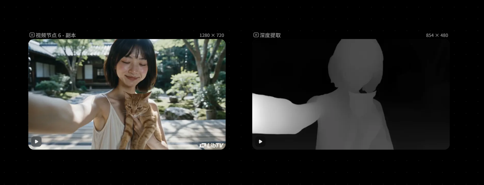
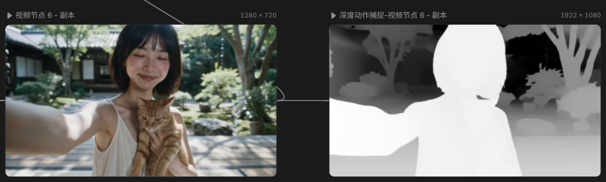
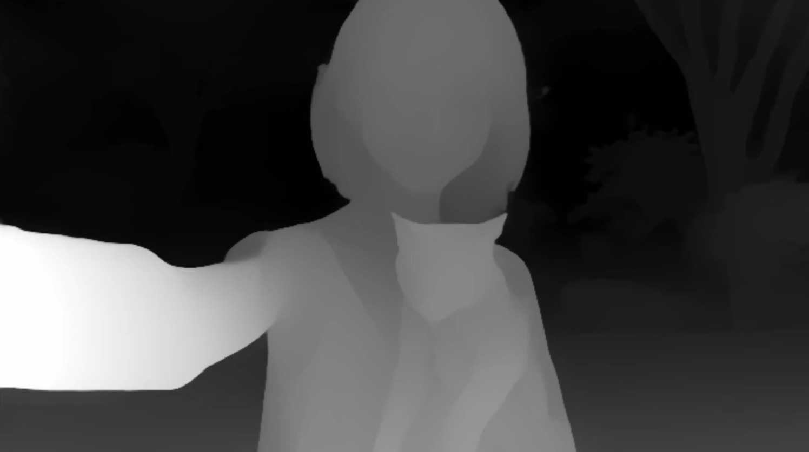

# LumenFigure

[English](README.en.md)

把视频里的人物动作抽成**灰阶深度影像**，给后续的 AI 视频生成当作动作复刻参考。成片不再保留原片的色彩和纹理：背景花纹、服装颜色、布料图案这些容易被生成模型一起抄进去的因素会被拿掉，留下轮廓和远近。离镜头越近越亮，例如朝镜头伸手时，从肩膀到手会逐渐变亮。

本项目复刻了 [里布 TV（LibTV）](https://www.liblib.tv/) 与 [OiiOii](https://www.oiioii.ai/) 的视频人物动作深度提取。对照见下方截图：本项目的灰阶层次和 OiiOii 的深度提取更接近；里布 TV 的深度动作捕捉会把人物收成纯色剪影，头部、手臂和躯干内部的轮廓被涂平。生成模型如果需要人物内部轮廓，纯色剪影能提供的形体信息更少。

```text
输入视频 → 可选的 RVM 抠人 → Video Depth Anything 流式相对深度 → 近亮远暗 → 无音轨 H.264
```

仓库里带有 Robust Video Matting 的推理代码，因此整体以 **GPL-3.0** 发布。第三方来源、许可证和权重地址见 [THIRD_PARTY.md](THIRD_PARTY.md)。

## 目录

- [效果对照](#效果对照)
- [环境要求](#环境要求)
- [安装](#安装)
- [使用](#使用)
- [参数](#参数)
- [常见问题](#常见问题)
- [本机速度](#本机速度)
- [许可证](#许可证)

## 效果对照

三张图是同一段人物自拍。前两张是产品界面截图，第三张是本项目导出画面的局部。

**OiiOii 深度提取。** 左侧是原片，右侧是灰阶深度。人物内部有深浅，背景也按远近留着一层灰。



**里布 TV 深度动作捕捉。** 人物变成一块纯白剪影，手臂、肩颈和躯干内部不再分开。



**本项目。** 由下面这条命令导出，画面是输出的局部。伸向镜头的手臂最亮，肩颈和躯干按相对深度保留层次，和 OiiOii 的灰阶深度更接近。

```powershell
python -m lumenfigure -i examples/clip2.mp4 -o examples/clip2_output.mp4 --no-matte --depth-size 392 --max-side 1080 --shadow 0.01
```



`--no-matte` 按整帧深度铺灰阶，背景的远近还会留在画面里，只是失去原来的颜色和纹理。默认会先用 Robust Video Matting 抠出人物，背景变成纯黑；服装的颜色和图案同样不会进入成片，衣服只作为形体上的深浅留下来。两种模式都去掉原图像素，差别在于背景是整帧深度，还是被抠掉。

### 动作复刻示例

下面三段都能在 GitHub 上点开播放。`clip1_result.mp4` 是拿深度结果去做 AI 动作复刻之后的成片，分辨率和帧率由生成模型决定，和前两段不一致。

| 步骤 | 文件 | 画面 | 帧率 | 时长 |
| --- | --- | --- | --- | --- |
| 原视频 | [examples/clip1.mp4](examples/clip1.mp4) | 1518×622 | 18 fps | 7.2 秒，129 帧 |
| 本项目导出的深度 | [examples/clip1_output.mp4](examples/clip1_output.mp4) | 1080×442 | 18 fps | 7.2 秒，129 帧 |
| AI 动作复刻结果 | [examples/clip1_result.mp4](examples/clip1_result.mp4) | 864×496 | 30 fps | 6.5 秒，195 帧 |

`clip1_output.mp4` 的长边是 1080，这是 `--max-side 1080` 把原片长边缩小后的尺寸。

## 环境要求

安装步骤不绑定某一颗 CPU 或某一张显卡。只要能装上对应的 PyTorch，就可以跑。

| 项目 | 要求 |
| --- | --- |
| 操作系统 | Windows、Linux 或 macOS |
| Python | 3.10 或更新版本。本仓库在 Python 3.13 上开发和测试 |
| 显卡 | 有 NVIDIA 显卡并装好驱动时走 CUDA，速度明显更快。没有 NVIDIA 显卡时用 CPU，可以出结果，只是慢 |
| 磁盘 | PyTorch 的 CUDA 轮子大约 2–3 GB。两个权重文件大约 15 MB 和 111 MB |
| 网络 | 需要能访问 PyPI、PyTorch 轮子索引、GitHub Releases，以及 Hugging Face |

macOS 没有 CUDA。在 Mac 上会自动使用 CPU。

导出依赖系统里的 `ffmpeg`，并且要带 `libx264`。成片是 H.264、`yuv420p`、CRF 18 的 MP4，没有音轨，帧率与输入相同。

## 安装

下面的命令都在仓库根目录执行，也就是能看到 `lumenfigure/`、`requirements.txt` 和 `models/` 的那一层。程序通过 `python -m lumenfigure` 启动，不需要再执行 `pip install -e .`。

### 1. 获取代码

```bash
git clone <这个仓库的地址>
cd LumenFigure
```

### 2. 确认 Python

```bash
python --version
```

Windows 上如果 `python` 打开的是应用商店，或者提示找不到命令，改用官方安装器装好后的启动器：

```powershell
py -3 --version
```

安装 Python 时勾选 **Add python.exe to PATH**。版本需要大于等于 3.10。下文把可执行文件写成 `python`；如果你的机器上只有 `py -3` 或 `python3`，把命令里的 `python` 换成它。

Linux 若还没有对应版本：

```bash
sudo apt update
sudo apt install -y python3 python3-venv python3-pip
```

Debian/Ubuntu 上虚拟环境需要 `python3-venv`。装完后用 `python3` 代替 `python`。

### 3. 创建并激活虚拟环境

虚拟环境用来把 PyTorch 和本仓库的依赖与系统 Python 隔开。

**Windows PowerShell**

```powershell
python -m venv .venv
.\.venv\Scripts\Activate.ps1
```

如果提示脚本被执行策略禁止，在当前用户下放行本地脚本后再激活：

```powershell
Set-ExecutionPolicy -Scope CurrentUser RemoteSigned
.\.venv\Scripts\Activate.ps1
```

**Windows 命令提示符（cmd）**

```bat
python -m venv .venv
.\.venv\Scripts\activate.bat
```

**Linux / macOS**

```bash
python3 -m venv .venv
source .venv/bin/activate
```

激活成功后，提示符前面会出现 `(.venv)`。之后的 `python` 和 `pip` 都应该指向这个环境。可以用下面两条确认：

```bash
python -c "import sys; print(sys.executable)"
python -m pip install -U pip
```

打印出来的路径应落在本仓库的 `.venv` 里面。退出环境用 `deactivate`。

### 4. 安装 PyTorch

`requirements.txt` 不包含 PyTorch。需要先按自己的 Python 版本和 CUDA 版本安装 **同一索引** 上的 `torch` 和 `torchvision`，两者版本必须配套，不能混用 CPU 版和 CUDA 版。

先看驱动认到的显卡，以及驱动支持的最高 CUDA 版本：

```bash
nvidia-smi
```

右上角的 `CUDA Version` 是驱动能支持的上限，不是已经装进 Python 的版本。然后打开 [PyTorch 官方安装页](https://pytorch.org/get-started/locally/)，按页面上当前给出的命令安装。下面三条是常见写法，页面上的版本更新时以页面为准。

CUDA 12.6 轮子：

```bash
pip install torch torchvision --index-url https://download.pytorch.org/whl/cu126
```

CUDA 12.8 轮子：

```bash
pip install torch torchvision --index-url https://download.pytorch.org/whl/cu128
```

只有 CPU，或者在 macOS 上：

```bash
pip install torch torchvision --index-url https://download.pytorch.org/whl/cpu
```

轮子标签里的 `cu126` 表示这个包用 CUDA 12.6 编译，它需要驱动支持的 CUDA 不低于这个版本。它不要求显卡必须是某一款。驱动较旧、装完后 `torch.cuda.is_available()` 仍是 `False` 时，换一个不高于驱动上限的 CUDA 轮子，或者先更新 NVIDIA 驱动。

装完后确认 Python 能看到 PyTorch，以及 CUDA 是否可用：

```bash
python -c "import torch; print(torch.__version__); print('cuda', torch.cuda.is_available()); print(torch.cuda.get_device_name(0) if torch.cuda.is_available() else 'cpu')"
```

有 NVIDIA 显卡时，这里应打印 `cuda True` 和显卡名称。打印 `cuda False` 时，程序仍能用 `--device cpu` 运行。

### 5. 安装其余依赖

```bash
pip install -r requirements.txt
```

这里会安装 OpenCV、NumPy、tqdm、einops 和 easydict。

### 6. 安装 FFmpeg

导出阶段会调用 PATH 里的 `ffmpeg`，并使用编码器 `libx264`。只装了不带 x264 的精简构建时，写视频会失败。

**Windows**

用 winget 安装完整构建：

```powershell
winget install --id Gyan.FFmpeg -e
```

装完后**重新打开**终端，让 PATH 生效，然后再激活 `.venv`。

也可以到 [gyan.dev 的 FFmpeg 构建页](https://www.gyan.dev/ffmpeg/builds/) 下载 release essentials，解压后把其中的 `bin` 目录加进系统 PATH。

**Debian / Ubuntu**

```bash
sudo apt update
sudo apt install -y ffmpeg
```

**Fedora**

```bash
sudo dnf install -y ffmpeg
```

**macOS**

```bash
brew install ffmpeg
```

确认命令可用，并且编码器列表里有 `libx264`：

```bash
ffmpeg -version
```

```bash
ffmpeg -hide_banner -encoders | grep libx264
```

Windows PowerShell 把最后一条里的 `grep` 换成 `findstr`：

```powershell
ffmpeg -hide_banner -encoders | findstr libx264
```

### 7. 下载模型权重

权重放在 `models/`。该目录里的权重文件已加入 `.gitignore`，克隆仓库后需要自己下载。

| 文件 | 大约体积 | 用途 |
| --- | --- | --- |
| `models/rvm_mobilenetv3.pth` | 15 MB | Robust Video Matting 的 MobileNetV3 抠像。默认会用；加上 `--no-matte` 时可以不下载 |
| `models/video_depth_anything_vits.pth` | 111 MB | Video Depth Anything Small，相对深度，Apache-2.0 |

**Windows PowerShell** 请使用 `curl.exe`。PowerShell 里的 `curl` 是 `Invoke-WebRequest` 的别名，参数不同。

```powershell
New-Item -ItemType Directory -Force -Path models | Out-Null
curl.exe -L --fail -o models\rvm_mobilenetv3.pth https://github.com/PeterL1n/RobustVideoMatting/releases/download/v1.0.0/rvm_mobilenetv3.pth
curl.exe -L --fail -o models\video_depth_anything_vits.pth https://huggingface.co/depth-anything/Video-Depth-Anything-Small/resolve/main/video_depth_anything_vits.pth
```

**Linux / macOS**

```bash
mkdir -p models
curl -L --fail -o models/rvm_mobilenetv3.pth https://github.com/PeterL1n/RobustVideoMatting/releases/download/v1.0.0/rvm_mobilenetv3.pth
curl -L --fail -o models/video_depth_anything_vits.pth https://huggingface.co/depth-anything/Video-Depth-Anything-Small/resolve/main/video_depth_anything_vits.pth
```

下载结束后看一下体积。深度权重大约 111 MB。如果只有几 KB，多半下到的是错误页面，删掉后重下，或用浏览器打开上面的地址另存为同名文件。

请使用 Small 这份 `vits` 权重。Video Depth Anything 的 Base / Large 权重是 CC-BY-NC-4.0，不能当作本仓库的默认模型，接口也不直接兼容。说明见 [THIRD_PARTY.md](THIRD_PARTY.md)。

### 8. 检查能否启动

仍在仓库根目录、虚拟环境已激活时执行：

```bash
python -m lumenfigure -h
```

能打印参数说明就表示代码路径和依赖可用。真正转换前还要有权重和 `ffmpeg`。

## 使用

输入、输出都是路径。输出目录不存在时会自动创建。建议把自己的结果写到 `output/`，这个目录已被忽略，不会和仓库里的示例混在一起。

只做整帧深度，背景按远近留成灰阶：

```bash
python -m lumenfigure -i input.mp4 -o output/depth.mp4 --no-matte --depth-size 392 --max-side 1080 --shadow 0.01
```

默认会抠人，背景为纯黑，人物内部仍按深度区分明暗：

```bash
python -m lumenfigure -i input.mp4 -o output/person.mp4
```

日志里如果出现 `xFormers not available`，表示深度模型没有用到可选的 xFormers 加速，推理会继续，不需要单独安装。

必须在本仓库根目录运行。在上一级目录执行时，Python 会报 `No module named lumenfigure`。每次新开终端都要重新激活 `.venv`。

CUDA 显存不够时，程序会丢掉当前深度图并自动重试：先把 `--depth-size` 降到 392，仍不够再降到 280。降档只发生在显存不足时，不会为了提速自行改参数。

## 参数

```text
python -m lumenfigure -i INPUT -o OUTPUT [选项]
```

### 模型与设备

| 参数 | 默认 | 说明 |
| --- | --- | --- |
| `--rvm-weights` | `models/rvm_mobilenetv3.pth` | 抠像权重 |
| `--depth-weights` | `models/video_depth_anything_vits.pth` | 深度权重，对应 Small / vits |
| `--device` | `auto` | `auto`、`cuda` 或 `cpu`。`auto` 在 CUDA 可用时用 GPU |
| `--fp16` / `--no-fp16` | 开启 | CUDA 上用 FP16。CPU 推理固定为 FP32 |

### 速度与分辨率

| 参数 | 默认 | 说明 |
| --- | --- | --- |
| `--depth-size` | `518` | 深度网络输入边长。越小越快，轮廓越粗。常用 518、392、280，三者都是 14 的倍数 |
| `--max-side` | `1920` | 推理前把画面长边缩到这个值。`0` 表示保持原始分辨率 |
| `--depth-stride` | `1` | 保留的兼容参数。流式深度必须逐帧计算，这个值会被忽略 |

`--max-side` 决定成片分辨率，`--depth-size` 决定网络内部看多细。长边已经不大时，继续提高 `--max-side` 不会再放大画面。

### 抠像与明暗

| 参数 | 默认 | 说明 |
| --- | --- | --- |
| `--matte` / `--no-matte` | 抠像 | 抠像后背景为纯黑。`--no-matte` 把整帧按深度铺成灰阶 |
| `--highlight` / `--max-luma` | `1.0` | 最近处的亮度，范围 0–1 |
| `--shadow` / `--min-luma` | `0.12` | 最远处人物的亮度下限，范围 0–1，必须小于高光 |
| `--contrast` | `1.0` | 远近拉开的程度。大于 1 更分明，小于 1 更平 |
| `--gamma` | `0.85` | 明暗曲线。小于 1 时近处更亮，大于 1 时高光被压住 |
| `--temporal-smooth` / `--no-temporal-smooth` | 开启 | 对深度和明暗分位做时间平滑，减轻闪烁 |
| `--blur-depth` | 关闭 | 给深度一个小核模糊，剪影更像海报 |
| `--blur-kernel` | `5` | 模糊核大小，偶数会自动加 1 |

明暗可以这样调：后排太黑，把 `--shadow` 提高到 `0.25`；手不够亮，保持 `--highlight 1.0`，把 `--gamma` 降到 `0.7`；远近糊成一片，把 `--contrast` 提高到 `1.4`。这些参数不改变推理速度。

人物不按实例分开，所有人共用一张 alpha，明暗来自逐像素相对深度。合成时不使用原图像素。抠像的软边缘会保留，避免轮廓锯齿。Video Depth Anything 使用流式时间缓存，深度比逐帧单图更稳；默认的时间平滑会再压一层闪烁。

## 常见问题

`No module named lumenfigure`

当前目录不是仓库根目录，或者没有激活 `.venv`，用到了另一个 Python。先 `cd` 到本仓库，再激活环境。

`ffmpeg was not found on PATH`

新开一个终端，执行 `ffmpeg -version`。Windows 上刚装好时，旧终端不会继承新的 PATH。

`RVM weights not found` **或** `Depth weights not found`

权重不在 `models/`，或文件名不一致。只跑 `--no-matte` 时可以没有 RVM 权重，深度权重仍然必需。

**CUDA out of memory**

程序会自动把 `depth-size` 降到 392，再降到 280。仍然失败时，换更小的 `--max-side`，或加上 `--no-matte` 少跑一个网络。

**下载的** `.pth` **只有几 KB**

Hugging Face 或 GitHub 返回了错误页。加上 `curl` 的 `--fail` 可以避免把错误页存成权重；已经下坏的文件删掉后重下。

**深度结果闪烁**

保持默认的 `--temporal-smooth`。流式模型要看每一帧，`--depth-stride` 不能用来跳帧加速。

## 本机速度

下面的数字只来自作者当前这台电脑，用来说明 `--depth-size` 和 `--max-side` 在同一段素材上的差别。其他显卡、驱动和分辨率都会不同。

| 项目 | 配置 |
| --- | --- |
| CPU | AMD Ryzen 5 5600 |
| GPU | NVIDIA GeForce GTX 1660 Ti，6 GB |
| 系统 | Windows |
| Python | 3.13 |
| PyTorch | 2.14.0+cu126，torchvision 0.29.0+cu126 |
| 精度 | CUDA FP16，未安装 xFormers |

素材是 [examples/clip2.mp4](examples/clip2.mp4)：1280×720，24 fps，121 帧。速度是进度条给出的平均值，包含读帧、推理和编码。同一档重复跑过的，把几次结果都列出来。`gamma`、`shadow` 这一类明暗参数没有改变速度。

**不抠像（**`--no-matte`**）**

| `--depth-size` | `--max-side` | 速度           |
| -------------- | ------------ | ------------ |
| 280            | 720          | 6.70 frame/s |
| 280            | 1080         | 6.58 frame/s |
| 392            | 1080         | 3.21 frame/s |
| 518            | 1080         | 1.55 frame/s |

**抠像（默认）**

| `--depth-size` | `--max-side` | 速度           |
| -------------- | ------------ | ------------ |
| 280            | 1080         | 4.97 frame/s |

这段 720p 素材上，`depth-size` 518 配合长边 1080 和 1920，测得的速度都是 1.55 frame/s，耗时主要在深度网络的输入边长。6 GB 显存跑完了上表里的全部分辨率；显存更紧的机器会触发前面的自动降档。上面对照截图用的是不抠像、`depth-size` 392、`max-side` 1080，对应 3.21 frame/s 那一档。

## 许可证

[GPL-3.0](LICENSE)。原因和上游项目地址写在 [THIRD_PARTY.md](THIRD_PARTY.md)。
